 

 

---

## About

Hi, I'm Yug. I like starting from a problem and building something that actually works.

I think about the idea and the experience first, and I use AI every day to prototype, test, and ship faster.

- I care more about solving the problem than about a job title.
- AI is a real part of how I work, from the first sketch to the final test.
- Two things I built recently are below. Take a look.

---

## Tech I build with

> Click any logo to open its official site.

---

## Projects

### 📈 [Bharat Stock Predictor](https://github.com/yugmakkar/Stock-Market-Predictor)

A forecasting tool for NSE-listed Indian stocks, built on free public data with no API keys or logins. It projects a transparent price range over the next 20 trading days, explains every signal in plain English, and backtests itself honestly. The prediction engine is a deterministic statistical model (no black box), and every part is unit tested.

`Next.js 16` · `React 19` · `TypeScript` · `Tailwind CSS v4` · `Recharts` · `Vitest` · `Playwright`

### 🎓 [GGSIPU Result Analysis & CGPA Calculator](https://github.com/yugmakkar/ggsipu-result-analysis)

A full-stack engine that reads a university result PDF, pulls out each subject's marks, and stores a student's marksheet. The SGPA, CGPA, and topper analytics are built and switch on once end-semester data is available. It runs on H2 out of the box or MySQL in production, with real security built in (PBKDF2 hashing, CSRF tokens, login lockout, prepared statements).

`Java 17` · `JDBC` · `Servlets / JSP` · `MySQL` · `H2` · `Apache PDFBox` · `JUnit`

---

## GitHub

 

  

<picture>
  <source media="(prefers-color-scheme: dark)" srcset="https://raw.githubusercontent.com/yugmakkar/yugmakkar/output/github-snake-dark.svg" />
  <source media="(prefers-color-scheme: light)" srcset="https://raw.githubusercontent.com/yugmakkar/yugmakkar/output/github-snake.svg" />
  
</picture>

---

## Contact

Open to roles, collaborations, and interesting problems.

**LinkedIn:** [linkedin.com/in/yug-makkar](https://www.linkedin.com/in/yug-makkar/)
**Email:** [yugmakkarongit@gmail.com](mailto:yugmakkarongit@gmail.com)

