  

 

I'm Yug, a creative thinker and AI leverager. I start from the problem, not the job title, and AI rides along from the first sketch to the final test, so ideas turn into working products fast.

 

Every gadget links to its maker's official site.

 

**[Bharat Stock Predictor](https://github.com/yugmakkar/Stock-Market-Predictor)**: forecasts NSE-listed Indian stocks from free public data, with a transparent 20-day price range, plain-English signals, and honest backtests.

**[GGSIPU Result Analysis & CGPA Calculator](https://github.com/yugmakkar/ggsipu-result-analysis)**: reads a university result PDF and stores each student's marksheet. SGPA, CGPA, and topper analytics switch on once end-semester data is available.

 

 

**LinkedIn:** [linkedin.com/in/yug-makkar](https://www.linkedin.com/in/yug-makkar/)
**Email:** [yugmakkarongit@gmail.com](mailto:yugmakkarongit@gmail.com)

 

